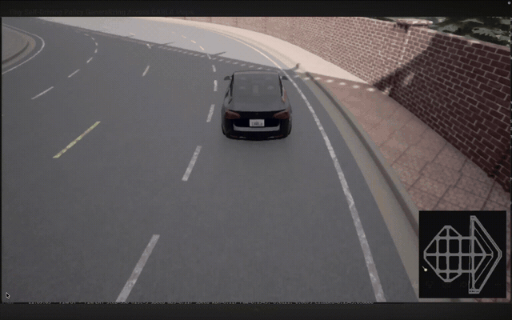
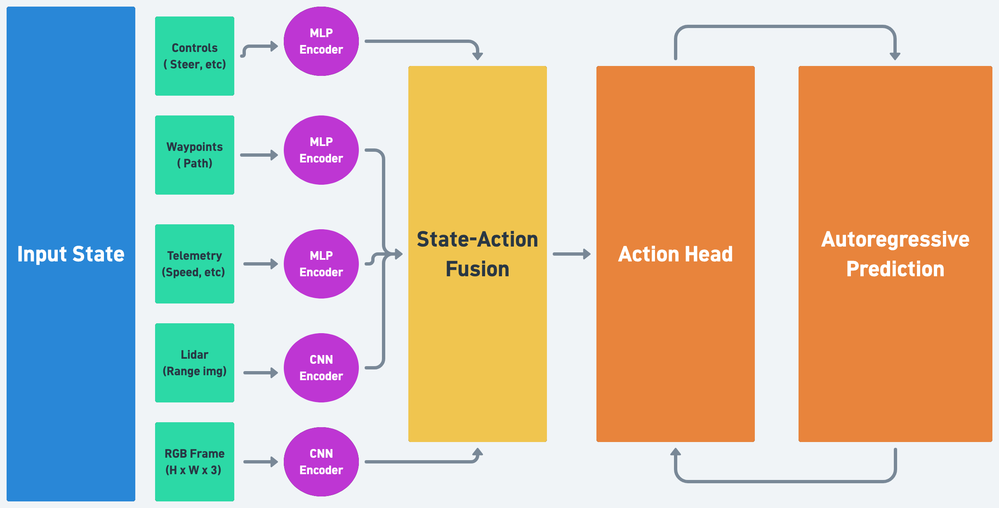
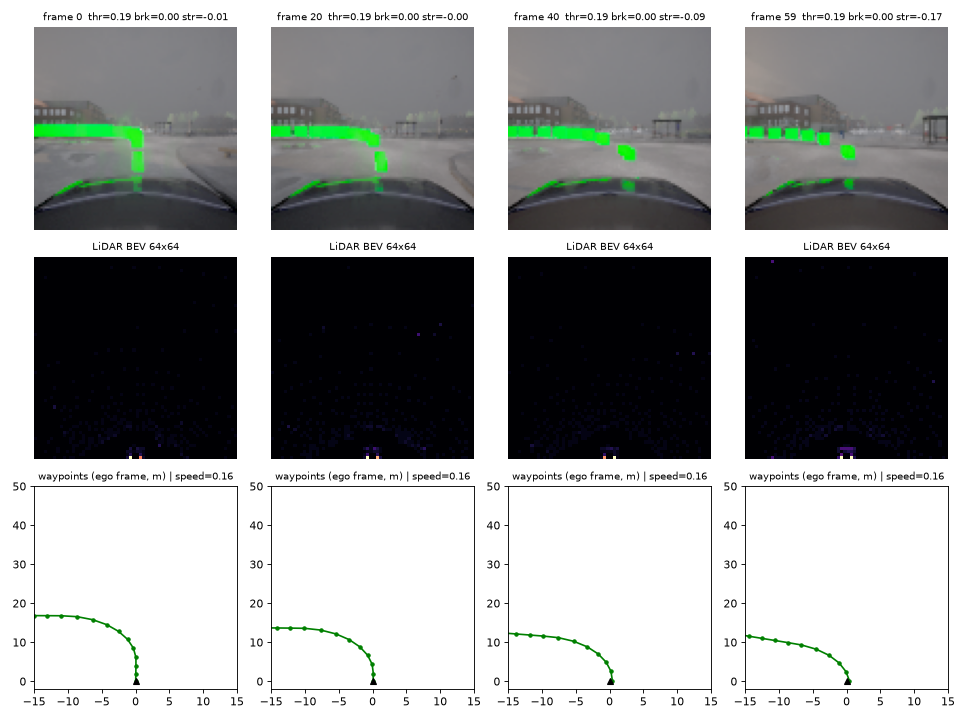
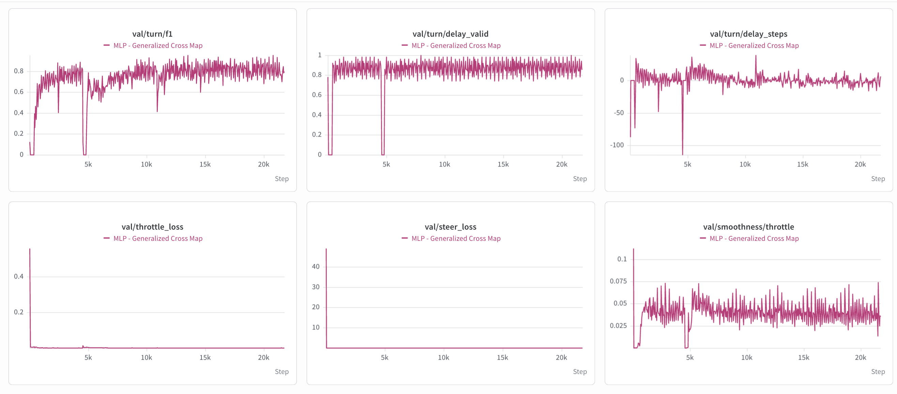

# Imitation Learning for Autonomous Driving in CARLA

<p align="center"></p>

A compact multimodal driving policy trained by **behavioral cloning** on expert demonstrations in the [CARLA](https://carla.org) simulator. The policy takes a short history of camera, LiDAR, vehicle telemetry and route waypoints and outputs continuous `throttle`, `brake` and `steer`. It then drives closed-loop: each prediction changes the next observation.

▶️ **Full demo video:** https://youtu.be/rr_uS4bf0B4 · 📄 **Technical report:** [paper/paper.md](paper/paper.md) · 📈 **Training run:** [W&B](https://wandb.ai/drift-ai-models/drift-mlp/runs/barzksni)

This repository is a minimal, end-to-end reproduction of the pipeline:

1. **Record** demonstrations by driving yourself (`drive.py`), or
2. **Collect at scale** with the CARLA autopilot as the expert (`collect.py`),
3. **Preprocess** recordings into training shards and a window index (`preprocess.py`),
4. **Train** the policy (`train.py`),
5. **Drive** with the trained policy in CARLA (`drive.py`, press `K`).

The trained policy is included in `artifacts/` as both Keras and ONNX.

---

## Contents

- [Model](#model)
- [Repository layout](#repository-layout)
- [Requirements](#requirements)
- [Setup](#setup)
- [Usage](#usage)
- [Data format](#data-format)
- [Training details](#training-details)
- [Known quirks and limitations](#known-quirks-and-limitations)

---

## Model



*Conceptual overview. In the released checkpoint the inputs are RGB, LiDAR BEV, telemetry and waypoints. Past control commands are not an input.*

```
 RGB 96×96 ─┐ Conv32-64-128 + GAP ──┐
 LiDAR BEV ─┤ Conv32-64-128 + GAP ──┤
 64×64      │                       ├─ concat (320) → Dense 256 ─┐
 Telemetry ─┤ Dense 32 ─────────────┤                            │  + positional embedding
 (5)        │                       │                            ▼
 Waypoints ─┘ Flatten → Dense 32 ───┘              2 × Transformer block (4 heads, key 64, FFN 512)
 (25×3)                                                           │
   × 5 timesteps (per-timestep encoders, shared weights)          ▼ last timestep
                                                          Dense 128 → [throttle, brake, steer]
```

| | |
|---|---|
| Inputs | 5-frame stacks: `vision (5,96,96,3)` float [0,1], `lidar (5,64,64,1)`, `telemetry (5,5)`, `waypoints (5,25,3)` |
| Output | `controls (3,)` = throttle, brake, steer (clip to [0,1], [0,1], [-1,1] before applying) |
| Parameters | 1,358,211 |
| Loss | Huber(throttle) + Huber(brake) + MSE(steer) |
| Control rate | 20 Hz (CARLA synchronous mode, `fixed_delta_seconds = 0.05`) |

**Observations** (all in the ego-vehicle frame; computed in `vehicle/`):

| Modality | Details |
|---|---|
| RGB camera | 224×224, FOV 90°, mounted at x=0.4 m, z=1.6 m; resized to 96×96 for the model |
| LiDAR | 32 channels, 50 m range; points with 0<x<30 m and -10<y<10 m binned into a 64×64 bird's-eye-view histogram, max-normalized |
| Telemetry | `tanh`-scaled speed (m/s), speed (km/h), acceleration magnitude, forward velocity, lateral velocity |
| Waypoints | next 25 lane-center waypoints, 2 m apart, each as `(x/d, y/d, d/50)` where d is distance |

## Repository layout

```
├── drive.py            # manual driving, autopilot, recording, policy inference (pygame window)
├── collect.py          # automated autopilot data collection over every spawn point of a map
├── preprocess.py       # raw recordings → processed TFRecords + Parquet window manifest
├── train.py            # behavioral-cloning training (W&B + S3 optional)
├── export_onnx.py      # Keras checkpoint → ONNX (with output parity check)
├── config.yaml         # the one non-secret config: sensors, data, training hyperparameters
├── .env.example        # the one place for credentials (W&B, AWS) — copy to .env
├── requirements.txt
│
├── artifacts/
│   ├── policy.keras    # trained policy
│   └── policy.onnx     # same policy exported to ONNX
├── samples/            # a 3-second slice of real processed data (see Data format)
├── assets/             # README / paper figures (architecture, driving GIF, training curves)
├── paper/              # technical report
├── vehicle/            # CARLA sensor rig, telemetry, waypoints (+ reward used by drive.py RL mode)
├── dataset/            # TFRecord schema, direction labels, window manifest, tf.data pipeline
├── model/              # policy architecture and training metrics
└── utils/              # config/.env loading, optional S3 helpers
```

## Requirements

| | |
|---|---|
| **CARLA** | **0.9.16** server. Windows or Linux with a dedicated GPU. See the [CARLA requirements](https://carla.readthedocs.io/en/latest/start_quickstart/#before-you-begin) (roughly an 8 GB+ GPU and 20 GB+ disk). |
| **Python** | 3.10–3.12 (3.11 recommended). The `carla` pip client must match the server version. |
| **OS** | **Windows / Linux**: everything. **macOS**: no CARLA, but `preprocess.py`, `train.py` and `export_onnx.py` work. |
| **GPU for training** | Recommended. TensorFlow on native Windows is CPU-only, so train on Linux, WSL2 or a cloud GPU. Driving inference runs fine on CPU. |

## Setup

### 1. Install CARLA 0.9.16

Download `CARLA_0.9.16` for your OS from the [CARLA releases](https://github.com/carla-simulator/carla/releases/tag/0.9.16) and extract it. Then start the server and leave it running:

```bash
# Windows
CarlaUE4.exe

# Linux
./CarlaUE4.sh
```

Town01–Town05 and Town10 ship with the base package. Other maps need the separate *AdditionalMaps* download. Rendering quality flags such as `-quality-level=Low` help on weak GPUs, but they also change the images the policy sees.

### 2. Python environment

```bash
git clone https://github.com/JordyKieto/carla-imitation-learning.git
cd carla-imitation-learning
```

**Windows (PowerShell)**
```powershell
py -3.11 -m venv .venv
.venv\Scripts\activate
pip install -r requirements.txt
```

**Linux / macOS**
```bash
python3.11 -m venv .venv
source .venv/bin/activate
pip install -r requirements.txt
```

### 3. Credentials (optional)

Everything runs locally without credentials. To log to Weights & Biases or sync data with S3:

```bash
cp .env.example .env     # Windows: copy .env.example .env
```

and fill in `WANDB_API_KEY` and/or `S3_BUCKET` + `AWS_*`. Nothing else in the repository holds secrets. `.env` is git-ignored.

> Run every script from the repository root.

## Usage

### 1. Drive and record yourself

```bash
python drive.py                 # Town01
python drive.py Town02          # another map
```

| Key | Action |
|---|---|
| Arrows | throttle / brake / steer |
| `R` | start/stop recording → `recordings/drive_<timestamp>.tfrecord` + `.json` summary |
| `P` | toggle CARLA autopilot (recording works in autopilot too) |
| `K` | toggle the trained policy |
| `I` / `U` | next / previous spawn point |
| `M` / `N` | next / previous map |
| `B` | minimap · `Y` reverse · `ESC` quit |

Keyboard input is binary (full throttle or none, full lock or none). The recorded throttle and steer labels are low-pass filtered and rate-limited (`DrivingInputContainer` in `drive.py`), so the policy learns smooth continuous controls.

`drive.py` also has experimental online modes: `G` (DAgger: alternates policy and autopilot windows and fine-tunes on autopilot labels) and `J` (reward-weighted RL fine-tuning).

### 2. Collect demonstrations at scale

`collect.py` automates recording with the CARLA Traffic Manager autopilot as the expert. For each spawn point it finds which maneuvers (left, right, straight) the upcoming junction allows. It then drives the autopilot from a slightly jittered start pose and classifies the maneuver it actually took from the change in yaw. It keeps a fixed number of recordings per maneuver, so the dataset covers turns and straights evenly.

```bash
python collect.py --map Town01
python collect.py --map Town02 --seconds 20 --captures-per-maneuver 2 --seed 0
python collect.py --help        # speed, jitter, attempts, start index, traffic rules...
```

Each capture writes `recordings/drive_<timestamp>.tfrecord` plus `.json` and `.route.json` metadata (map, spawn, maneuver, start pose).

### 3. Preprocess

```bash
python preprocess.py
```

Resizes vision to 96×96 and writes `datasets/processed/*.processed.tfrecord`. It also builds `datasets/windows_manifest.parquet`, which has one row per 5-frame window with a direction label (`straight`/`left`/`right`), quality flags and tags. Tags are the map (e.g. `Town01`) and the source script (`drive` or `collect`). Already-processed recordings are skipped on re-runs.

With S3: `python preprocess.py --pull --push` downloads raw recordings from `s3://$S3_BUCKET/raw/` and uploads the processed shards and manifest.

### 4. Train

```bash
python train.py                                   # defaults from config.yaml
python train.py --tags Town01 Town02              # only these maps (e.g. hold out others for evaluation)
python train.py --s3                              # pull data from S3, push checkpoints
python train.py --resume artifacts/policy.keras   # fine-tune the released policy
```

To try it without CARLA or any recordings, use the bundled samples:

```bash
python train.py --manifest samples/windows_manifest.parquet --processed-dir samples --epochs 1 --val-steps 5
```

Checkpoints go to `checkpoints/policy_epoch_XXX.keras`. Metrics print to stdout, and go to W&B when `WANDB_API_KEY` is set.

### 5. Drive with a policy

```bash
python drive.py Town01 artifacts/policy.keras     # then press K
python drive.py Town03 checkpoints/policy_epoch_010.keras
```

### ONNX

`artifacts/policy.onnx` is the same network (max output difference vs. Keras ≈ 3e-7; inputs `vision`, `lidar`, `telemetry`, `waypoints`, output `controls`). Re-export any checkpoint with `python export_onnx.py path/to/checkpoint.keras`.

```python
import numpy as np, onnxruntime as ort

session = ort.InferenceSession("artifacts/policy.onnx")
feeds = {
    "vision":    np.zeros((1, 5, 96, 96, 3), np.float32),   # RGB / 255
    "lidar":     np.zeros((1, 5, 64, 64, 1), np.float32),
    "telemetry": np.zeros((1, 5, 5), np.float32),
    "waypoints": np.zeros((1, 5, 25, 3), np.float32),
}
throttle, brake, steer = session.run(["controls"], feeds)[0][0]
```

## Data format

Recordings are TFRecords with one `tf.train.Example` per 20 Hz frame. Each feature holds the raw bytes of a numpy array:

| Feature | Raw (`recordings/`) | Processed (`datasets/processed/`) |
|---|---|---|
| `vision` | uint8 `(224, 224, 3)` RGB | uint8 `(96, 96, 3)` |
| `lidar` | float32 `(64, 64, 1)` | same |
| `telemetry` | float32 `(5,)` | same |
| `waypoints` | float32 `(25, 3)` | same |
| `controls` | float32 `(3,)` throttle, brake, steer | same |

`samples/` contains 60 consecutive frames (3 s, going straight and then into a left turn) of real processed data, the matching `.meta.json` with per-frame labels, and a 56-window `windows_manifest.parquet`:



Reading a file directly:

```python
import tensorflow as tf
from dataset.records import parse_processed

for proto in tf.data.TFRecordDataset("samples/sample_drive.processed.tfrecord").take(1):
    (vision, lidar, telemetry, waypoints), controls = parse_processed(proto)
    print(vision.shape, lidar.shape, telemetry.numpy(), controls.numpy())
```

## Training details

`config.yaml` defaults match the W&B run **"MLP - Generalized Cross Map"** ([`barzksni`](https://wandb.ai/drift-ai-models/drift-mlp/runs/barzksni), project `drift-mlp`). `artifacts/policy.keras` is that run's **epoch-10 checkpoint**: it was saved 1,114 s into the run, when epoch 10 completed.

| | |
|---|---|
| Dataset | 236,882 windows (≈3.3 h at 20 Hz); 89.5% straight, 5.9% left, 4.7% right |
| Split | 165,777 train / 71,108 validation windows |
| Optimizer | Adam, lr 3e-3 |
| Batch size | 409 windows |
| Window | 5 frames (0.25 s), target = last frame's controls |
| Data filter | windows whose frames share one direction label ≥ 60%; quality flag `ok` |
| Split rule | per recording and direction, first 70% of windows → train, remaining 30% → validation |
| Validation | 50 batches every 50 training steps |
| Run length | 53 epochs, 21,750 steps, 8.8 M windows seen, 1.6 h |

Metrics logged: per-control losses, MAE/RMSE/R², per-direction loss, turn precision/recall/F1 (|steer| > 0.1), turn onset delay, lagged error and prediction smoothness.



## Known quirks and limitations

Worth knowing before building on this or interpreting results:

- **Offline metrics ≠ driving ability.** Validation losses measure action prediction on expert states. Driving is closed-loop, where small errors compound, so evaluate policies by driving them.
- **Validation comes from the same recordings as training**: a later, contiguous part of each recording, not held-out routes or maps. Use `--tags` to hold maps out.
- **Waypoints follow the lane, not a planned route.** At junctions the waypoint generator takes the first successor lane, so the waypoints do not always show which turn the expert takes.
- **Debug waypoints appear in the camera.** `collect.py` (and `drive.py` in autopilot/policy mode) draws the waypoints as green points in the CARLA world, and these show up in the recorded RGB frames (visible in `samples/preview.png`).
- **The positional embedding is not learned.** Keras 3 evaluates it once when the model is built, so it is a fixed random constant in the graph (see `model/policy.py`).
- **Telemetry `speed_mps` and `speed_kph` are identical** after scaling (`tanh(v/20)` both).
- **LiDAR BEV normalization** divides by the max bin, and the few returns closest to the ego vehicle often dominate it.
- Simulation only. No other vehicles or pedestrians by default, and `collect.py`'s autopilot ignores traffic lights and stop signs.
